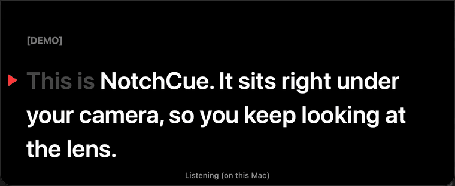

# NotchCue

A teleprompter for macOS that hangs down from the notch, right under your camera, and follows your voice.

<p align="center"></p>

Read your script out loud and NotchCue scrolls along with you. Words you've said turn grey, it waits when you pause, and if you go back and say a line again it jumps back to it. Because the text sits right below the camera, your eyes stay close to the lens.

It only uses what's built into macOS: Apple's speech recognition runs on your Mac, so it works offline and nothing is sent anywhere by NotchCue. No accounts, no subscription.

## Install

Needs macOS 13 (Ventura) or later, on Apple silicon or Intel.

### Homebrew (coming soon)

```sh
brew install --cask lycanaai/tap/notchcue
```

This installs NotchCue.app into `/Applications` and the `notchcue` command into Homebrew's `bin`. `brew upgrade --cask notchcue` updates both. Not available yet: it will work once the first public release is out.

### Download

Download `NotchCue-<version>.zip` from [Releases](https://github.com/LycanaAI/notchcue/releases), unzip it and drag NotchCue.app into Applications.

For the command line, link the launcher inside the app onto your `PATH`:

```sh
ln -s /Applications/NotchCue.app/Contents/Resources/notchcue /usr/local/bin/notchcue
```

Releases are signed with a Developer ID and notarised by Apple, so macOS opens them without warnings. Because every release is signed by the same developer, the microphone and speech permissions you grant carry over when you update.

### Build from source

Needs the Xcode command line tools (`xcode-select --install`).

```sh
git clone https://github.com/LycanaAI/notchcue.git
cd notchcue
make install
```

This does two things:

- **The app:** copies NotchCue.app into `~/Applications`, so you can open it from Spotlight (⌘Space, type "NotchCue") or Launchpad.
- **The command:** links `notchcue` into `~/.local/bin`. Make sure that's on your `PATH`, or use `make install PREFIX=/usr/local`.

Rebuilding from the command line also refreshes the copy in `~/Applications` (unless that copy is a downloaded release). `make uninstall` removes both.

Local builds are signed with your Apple Development certificate if you have one (from Xcode), so macOS remembers the permissions across rebuilds. Without one they get an ad-hoc signature, and macOS asks again after each rebuild. To choose the certificate yourself, set `NOTCHCUE_SIGN_IDENTITY` to its name or SHA-1 hash, or to `-` for ad-hoc.

The first time it listens, macOS asks for **Speech Recognition** and **Microphone** access. **Dictation must also be on**: System Settings → Keyboard → Dictation. Without it, Apple's speech recognition won't run and NotchCue tells you so.

## Opening a script

- **From Spotlight or Launchpad:** open NotchCue. With no script, the panel says "Drop a script here, press ⌘O, or paste with ⌘V", with buttons to open a file or try a sample.
- **Drag and drop:** drop a file onto the panel, or onto NotchCue.app in Finder or the Dock. You can also drop selected text onto the panel.
- **⌘O**, or **Open Script…** in the menu bar. **Open Recent** in the menu lists your last 5 scripts.
- **⌘V** pastes the text on the clipboard as the script (or opens a copied file).
- **From the command line:**

  ```sh
  notchcue script.txt                       # follow your voice
  notchcue notes.md                         # Markdown, Word, RTF, HTML and PDF work too
  notchcue script.txt --steady --wpm 160    # steady scroll instead
  notchcue --text "Some text to read"       # text straight from the command line
  pbpaste | notchcue -                      # text from a pipe
  notchcue                                  # the welcome panel
  notchcue --help                           # all options
  ```

  The command returns straight away and leaves the window open, so scripts and AI agents can launch it. Add `--wait` to block until it's closed. Running it again replaces the NotchCue that's open.

## Supported formats

| Format | How it's read |
|---|---|
| `.txt` | As is. Each line is a paragraph; lines in `[square brackets]` are grey cues that aren't read out. |
| `.md`, `.markdown` | Headings become cues; bold, italic, code and link markup are stripped; images, code blocks, HTML comments and front matter are left out. |
| `.docx`, `.doc`, `.rtf`, `.rtfd`, `.odt`, `.html`, `.htm`, `.webarchive` | The text only, through macOS's document reader. |
| `.pdf` | The text, with lines joined back into paragraphs. Scanned PDFs have no text to read. |

Anything else shows a message in the panel saying which formats work. [docs/script-format.md](docs/script-format.md) has the full rules and an example.

## The menu bar

NotchCue has no Dock icon. While it's running, its icon (three centred lines) sits in the menu bar and is the main control:

- **Open Script…** (⌘O), **Open Recent**, **Paste Script** (⌘V)
- **Pause / Resume**, **Follow Voice** or **Steady Scroll**, **Back to Top**
- **Text Size** (bigger / smaller) and **Speed** (for a steady scroll)
- **Show / Hide Panel** and **Minimise**
- **Settings…** (⌘,), **Help**, **Full Guide on GitHub**, **Quit NotchCue** (⌘Q)

Opening NotchCue again from Spotlight brings the panel back if you've hidden it.

## The panel

- **Hover controls:** move the mouse over the panel and a small row of buttons fades in at the bottom: pause/resume, voice/steady, smaller text, bigger text, minimise, settings, help (?) and close (✕). They fade out again when the mouse leaves or stays still for a couple of seconds, so they don't get in the way while you read.
- **Minimise:** press **M**, click the **⌃** hover button, or choose **Minimise** in the menu. The panel shrinks to a small pill under the notch showing:
  - a status dot: green when listening, orange when paused, blue when scrolling, grey when not listening
  - the rest of the line you're on
  - how far through the script you are

  Click the pill, press **M** (or Return), or choose **Expand Panel** in the menu to bring the full panel back where it was. While minimised, voice following keeps listening and keeps your place. A steady scroll stops while minimised and counts down again when you expand.
- **Help:** press **?**, click the **?** button, or choose **Help** in the menu for a cheat sheet over the text. It has the keys, how voice following works, the Dictation setting and permissions, and a link to this guide. **Esc** or **?** closes it.
- **Move it:** drag the panel anywhere.

## Settings

Open with ⌘, or **Settings…** in the menu. Changes apply straight away and are kept for next time:

| Setting | Default | Command-line option |
|---|---|---|
| Text size | 40 pt | `--font-size N` |
| Panel width | 760 pt | `--width N` |
| Panel height (below the notch) | 280 pt | `--height N` |
| Speech language | Your system language | `--locale ID` (e.g. `en-AU`) |
| Start in | Follow voice | `--steady` or `--voice` |
| Steady speed | 150 words a minute | `--wpm N` |
| Countdown before a steady scroll | 3 seconds | `--countdown N` (0 = none) |

Options given on the command line override the settings for that run only.

## Keys

Click the panel first so it has the keyboard.

| Key | Action |
|---|---|
| Space | Pause / resume |
| V | Switch between following your voice and a steady scroll. If listening stopped, V tries again. |
| ↑ / ↓ | Steady scroll: faster / slower. Voice: move your place back / forward a word |
| + / − | Bigger / smaller text |
| R | Back to the top |
| M | Minimise / expand |
| ? | Help |
| ⌘O | Open a script |
| ⌘V | Paste a script |
| ⌘, | Settings |
| Esc or Q | Close NotchCue (Esc closes the help first if it's open) |

### Other options

| Option | |
|---|---|
| `--sample` | Show a short sample script |
| `--debug` | Log what it hears to `~/Library/Logs/notchcue.log` |
| `--validate` | Check the options and file, then exit without opening anything |
| `--show VIEW` | Open with `help`, `controls`, `minimised` or `settings` showing (for screenshots and testing) |
| `--self-test` | Run the built-in tests |

## Troubleshooting

- **"Turn on Dictation first":** Apple's speech recognition only runs with Dictation on. Turn it on in System Settings → Keyboard → Dictation, then press V.
- **It doesn't react to my voice:**
  - Check that NotchCue is allowed in System Settings → Privacy & Security → **Microphone** and → **Speech Recognition**.
  - Check the speech language in Settings matches the language you're reading.
- **macOS asks for permission again:** releases are signed and notarised, so this shouldn't happen when you update. If you build from source without an Apple Development certificate, the build has an ad-hoc signature, macOS treats each rebuild as a new app, and it asks again after you pull changes or edit the source. Allow it again, or see [Build from source](#build-from-source) for signing with a certificate.
- **The microphone is in use by another app:** if a video call or recording app has the microphone, NotchCue may hear nothing or say it couldn't start the microphone. Close or mute the other app, then press V (twice if needed) to start listening again. Recording apps that share the microphone, like QuickTime or OBS, usually work alongside it.
- **"Speech recognition stopped":** press V to retry. If it keeps happening, run with `--debug` and look at `~/Library/Logs/notchcue.log`.
- **I can't find the menu bar icon:** the panel covers the middle of the menu bar, and macOS hides icons that don't fit beside the notch, so on a crowded menu bar NotchCue's icon can end up hidden. Minimise the panel (M) to uncover more of the menu bar, quit some menu bar apps, or use the panel's hover controls and keys instead.
- **The panel is gone:** choose **Show Panel** in the menu bar, or open NotchCue again from Spotlight.

## How it works

- **Placement:** the panel is a borderless window at the top centre of the screen. Its top edge is the top of the screen: it covers the middle of the menu bar, and the notch sits inside its black top strip, so the notch and the panel look like one shape. The text starts just below the notch. On screens without a notch, the strip covers the middle of the menu bar in the same way.
- **Following your voice:** `SFSpeechRecognizer` streams partial transcripts from the microphone. NotchCue compares the last few words heard with the script around your current place, allowing for misheard and skipped words, and moves forward to the best match. It only jumps backwards on a strong match, so a common word like "the" can't send it back.
- **Why an app bundle:** macOS only lets apps with a reason in their `Info.plist` ask for the microphone and speech recognition, so the `notchcue` script builds a small `.app` and opens it.
- **Building:** `swiftc` compiles the files in `Sources/` with no other dependencies. `make check` compiles and runs the built-in tests, as CI does. `make release` builds the signed and notarised zip; see [docs/releasing.md](docs/releasing.md).
- **The command inside the app:** NotchCue.app carries the `notchcue` launcher in `Contents/Resources`. Run from there (or through a link to it), it opens the app it's in with your arguments and compiles nothing. Run from a source checkout, it builds first.

## Known quirks

- Speech recognition can mishear names and jargon. NotchCue passes the script's words to the recogniser as hints, and the matching tolerates the odd wrong word. If it loses you, press ↓ / ↑ to nudge it.
- PDFs don't record where paragraphs end, so paragraph breaks in a PDF script are a best guess.

## Licence

MIT
